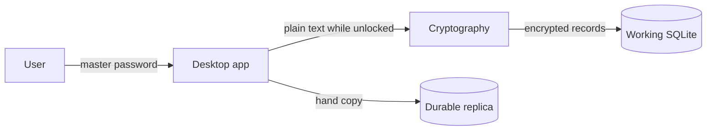

# Architecture

How KeyHolder is built.
For step-by-step flows, see [how-it-works.md](how-it-works.md).
For threats and checklists, see [security.md](security.md).

## 1. Goals and limits (version 1)

KeyHolder is a personal Windows vault for one person and one vault.
It works fully offline.
One host writes at a time.

**In version 1**

- encrypted SQLite replica moves between hosts **by hand** only
- each app folder keeps **one durable replica** (export uses a temp file, then replace)
- user must approve before an import replaces local data
- important recovery also needs a copy **outside** the app folder
- whole-vault replace (no field merge)
- **search** on 1–6 chosen fields: title, username, email, URL, `d-tags`, `s-tags`
- **filter** by `d-tags` and by `s-tags`
- **sort** by name, date, or importance

**Not in version 1**

Cloud sync, auto sync, two writers at once, browser extensions, autofill, sharing, attachments, web app, passkeys, remote wipe, server DB.

## 2. Entry model

Each entry has two encrypted parts:

```text
entry
  id
  metadata_envelope
    title          ← required
    username
    email
    url
    d-tags         ← Data Tags (type of data)
    s-tags         ← Security Tags (category / risk)
    importance     ← optional number for sort
  secret_envelope
    password
    notes
```

- **d-tags** and **s-tags** are separate free-text lists (no fixed dictionary).
  Examples: d-tags `Email`, `Account`; s-tags `Finance`, `Sensitive`.
- After unlock, metadata is available for search, filter, and sort.
- Password and notes stay encrypted until Reveal, Copy, or edit of that entry.
- The password box always shows `••••••••` (fixed length).

## 3. System parts



| Project | Role |
|---|---|
| Domain | Models and rules. No WPF, SQLite, or crypto packages. |
| Cryptography | Keys, wrapping, envelopes. Other code does not pick algorithms or nonces. |
| Infrastructure | SQLite, migrations, replica export/import, redacted logs. |
| Desktop | WPF + MVVM + DI. Starts locked. Locks on idle / Windows lock. |

```text
Desktop ──► Infrastructure ──► Domain
                 │
                 └──────────► Cryptography
```

## 4. Keys

```text
master password
    └── Argon2id + salt ──► password key ──► unwraps vault key

vault key
    ├── HKDF("metadata-v1") ──► metadata key ──► AES-256-GCM metadata envelopes
    └── HKDF("secrets-v1") ───► secret key ───► AES-256-GCM secret envelopes
```

- Master password is never stored.
- Password change rewraps the vault key; entry ciphertext can stay the same.
- Context strings are fixed for format v1.
- Each envelope has its own fresh nonce and checked context (vault ID, entry ID, kind, version).
- Use .NET `RandomNumberGenerator` and `AesGcm`, plus a maintained Argon2id package.

## 5. Local SQLite

```text
vault
  id, crypto_version, kdf_parameters, salt,
  wrapped_vault_key, recovery_wrapped_vault_key,
  created_at, updated_at

entry
  id, vault_id, metadata_envelope, secret_envelope,
  metadata_revision, secret_revision, is_deleted,
  created_at, updated_at

replica_state
  vault_id, replica_path, last_exported_at,
  local_changed_since_replica
```

Edits use transactions.
`local_changed_since_replica` flips in the same transaction as a successful change.
Metadata-only edits replace only `metadata_envelope`.
Secret edits replace only `secret_envelope`.

## 6. One durable replica

```text
working.sqlite      ← live vault
replica.sqlite      ← one durable copy
*.tmp.sqlite        ← only during export
```

**Export:** pause writes → consistent temp copy → check → replace durable file → delete temps → clear dirty flag.

**Import:** user picks a file → approve → check → temp DB → rollback copy → safe replace of working vault.

**Between hosts:** copy the durable file by hand. One writer at a time. No merge of two vaults.

**If the durable file is bad:** export again from a good working vault, or import an independent off-app copy.
There is no second long-lived replica in the app folder.
