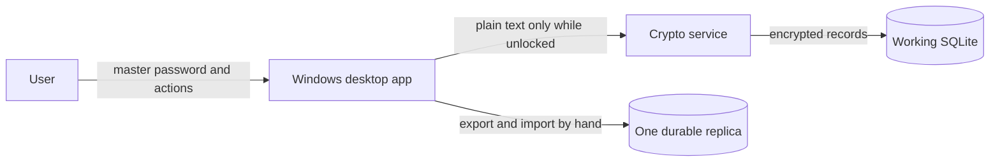

# Architecture

This file describes how KeyHolder is built.
Also read:

- [data flows](data-flows.md) — what happens step by step
- [threat-control matrix](threat-control-matrix.md) — why each safety part exists

## 1. Goals and limits

Each login entry has two locked parts:

- `metadata_envelope`: title, username, email, URL, `d-tags`, `s-tags`, and optional `importance`
- `secret_envelope`: password and notes

Only **title** is required.
All other fields are optional.

### Tags

`d-tags` and `s-tags` are two separate tag lists.
There is no fixed list of tags.
The user can set any string values on each entry.

- **d-tags (Data Tags):** describe the type of data, for example `Email`, `Account`, `Phone number`.
- **s-tags (Security Tags):** describe the category or risk of the data, for example `Finance`, `Sensitive`, `Location`.

### Importance

`importance` is an optional number on an entry.
The app uses it when sorting the list before display.

### Version 1 rules

- one person and one vault
- one primary writing device at a time
- complete offline operation
- encrypted SQLite replicas move between hosts **only by hand** (no cloud sync service)
- each hosted app keeps **one durable replica** next to the app (temp file only during export, then replace)
- user approval before an imported replica replaces local data
- important recovery also uses an **independent copy outside the app folder**
- whole-vault replacement, not field-level merging
- **search** using a customizable list of fields (choose 1 to 6 from: title, username, email, URL, `d-tags`, `s-tags`)
- **filter** by `d-tags` and by `s-tags`
- **sort** by name, date, or importance

Not in version 1: Cloudflare R2 or any automatic remote storage, auto sync, two writers at once, browser extensions, autofill, sharing, file attachments, a web app, passkeys, remote wipe, or server database queries.

## 2. System overview



The working database is the live vault on this device.
The app also keeps **one durable encrypted SQLite replica** next to the app.
During export it may create a temporary file, check it, then replace the durable replica.
You move that durable replica between hosts yourself (for example USB drive or encrypted disk).
There is no cloud upload in version 1.

Trust rules:

1. Clear vault text exists only inside the unlocked app.
2. Working SQLite, replica files, logs, and disks are not trusted for secrets.
3. A copied replica file must not reveal passwords or notes without the master password.
4. If Windows malware controls the unlocked app, it can read secrets.
5. A bad replica file can harm data only if the user replaces the working vault without checks.
   Staged import, temp+replace export, and an independent off-app copy reduce this risk.

## 3. Desktop design

### Domain

Simple C# models and actions like `CreateEntry`, `UpdateEntry`, `SearchEntries`, `FilterEntries`, `SortEntries`, `LockVault`, `ExportReplica`, `ImportReplica`, and `RestoreFromBackup`.
This project does not use WPF, SQLite, or crypto libraries.

### Cryptography

Owns key making, key wrapping, encryption, and secure random numbers.
Other code must not choose nonces, key sizes, or algorithms.

### Infrastructure

Does:

- local SQLite storage and migrations
- working database plus one durable replica
- safe export (temp + replace) and import of encrypted SQLite replicas
- local rollback copies during import
- logging with secrets removed

### Desktop

WPF with MVVM and dependency injection.
The app starts locked.
It asks before an imported replica replaces local data.
It locks after idle time or when Windows locks.

After unlock, the app unlocks metadata so you can search, filter, and sort.
Secret envelopes stay locked.
The password box always shows `••••••••`.
It does not show the real password length.
Reveal and Copy unlock only the selected entry’s secret part for a short time.

#### Search, filter, and sort

- **Search:** the user picks 1 to 6 fields from title, username, email, URL, `d-tags`, and `s-tags`.
  Search looks only in the chosen fields.
- **Filter:** the user can filter the list by `d-tags` and by `s-tags`.
- **Sort:** the user can sort by name (title), date, or importance.

WPF is preferred over WinUI 3 because it is mature, well documented, and enough for a personal Windows app.

## 4. Keys and encrypted records

```text
master password
    │
    └── Argon2id + random salt ──► password key
                                         │
                                         └── unwraps random vault key

random 256-bit vault key
    │
    ├── HKDF-SHA-256("metadata-v1") ──► metadata key
    └── HKDF-SHA-256("secrets-v1") ───► secret key

metadata key + AES-256-GCM ──► metadata envelopes
secret key + AES-256-GCM ───► secret envelopes
```

The master password is never saved or uploaded.
It makes a password key.
That key unlocks the random vault key.
If you change the master password, only the wrapping changes.
Entry ciphertext does not need to change.

HKDF keeps keys apart.
Metadata and secrets must not use the same key.
The exact context strings are part of format version 1.
Do not change them without a format upgrade.

Each metadata or secret envelope stores:

- format version
- algorithm name
- new random 96-bit nonce
- ciphertext
- 128-bit auth tag
- checked context: vault ID, entry ID, envelope kind (`metadata` or `secret`), and schema version

Use .NET `RandomNumberGenerator` and `AesGcm`.
Use a maintained Argon2id package.
Store salt, memory, iterations, and parallelism in the vault header.

Example plain text (only to show the model):

```json
{
  "metadata": {
    "title": "Example Mail",
    "username": "alex",
    "email": "alex@example.test",
    "url": "https://mail.example.test",
    "d-tags": ["Email"],
    "s-tags": ["Sensitive"],
    "importance": 3
  },
  "secret": {
    "password": "example-password",
    "notes": "Example private note"
  }
}
```

Each object is saved and encrypted on its own.
Only `metadata.title` must not be empty.
`importance` is optional.
In SQLite you may only see non-secret technical fields, for example:

- random vault and entry IDs
- envelope versions
- deleted flag if trash exists
- ciphertext size
- technical times

Password and notes share one secret envelope.
So Reveal or Copy must briefly unlock that whole selected secret part.
The UI shows only the field you asked for.
It clears temporary data when it can.
It never unlocks secret envelopes for other entries.

## 5. Local SQLite model

> **Milestone 1 note:** until the encrypted vault (Milestone 2), the `entry` table keeps the same two groups as plain columns
> (`title`, `username`, ... and `password`, `notes`) with separate revisions, and holds fake data only.
> See [ADR 0009](adr/0009-interim-plain-fake-data-schema.md). The schema below is the Milestone 2 target.

Suggested tables:

```text
vault
  id, crypto_version, kdf_parameters, salt,
  wrapped_vault_key, recovery_wrapped_vault_key,
  created_at, updated_at

entry
  id, vault_id, metadata_envelope, secret_envelope,
  metadata_revision, secret_revision, is_deleted,
  created_at, updated_at

replica_state
  vault_id, replica_path,
  last_exported_at,
  local_changed_since_replica
```

All local edits use SQLite transactions.
`local_changed_since_replica` is set in the same transaction as a successful change.
Metadata-only edits replace only `metadata_envelope`.
Password or notes edits replace only `secret_envelope`.
Each replace uses a new nonce and increases that envelope’s revision.

Do not copy the live working SQLite file while it may be changing.
To make a replica, use SQLite backup or an app export to a consistent temporary database, then replace the durable replica safely.

## 6. Replica model (one durable file)

Each hosted app keeps one durable encrypted SQLite replica next to the working vault:

```text
working.sqlite     ← live vault
replica.sqlite     ← one durable replica
replica.tmp.sqlite ← temporary only during export
```

(Exact file names may differ; the roles stay the same.)

### Export

1. Pause writes for a short time.
2. Make a consistent temporary SQLite copy of the working vault.
3. Check that the temporary copy opens and passes basic checks.
4. Replace the durable replica with the temporary file in one safe step.
5. Remove leftover temp files.
6. Clear `local_changed_since_replica` only after a successful export.

Never overwrite the durable replica in place without a checked temp file first.

### Manual move between hosts

1. Copy the durable replica file to the other host by hand.
2. On the other host, import that file with user approval.
3. Import checks the replica, asks for the master password if needed, restores into a temporary database, keeps a rollback, then replaces the working vault.
4. After a good import, export a new durable replica on that host if needed.

Version 1 does not merge two vaults.
The user chooses one full vault.

### Recovery when the durable replica is bad

If the durable replica is damaged, restore from an **independent copy outside the app folder**, or keep using the working vault and export again.
Version 1 does not keep a second long-lived replica beside the app.

## 7. Checking replica state

At application start or before import/export, the app can show simple states:

| State | Meaning | Action |
|---|---|---|
| Clean | Local matches the durable replica | Continue |
| Dirty | Local changed since last export | Offer export |
| Import offered | User selected an external replica file | Ask approval, then staged import |
| No vault | New device | Create vault or import a replica |

Timestamps help display only.
They do not prove which vault should win.

## 8. Import and restore protocol

When the user imports a replica file:

1. Copy the file to a temporary location with size and path limits.
2. Ask for the master password.
3. Open and check the temporary SQLite (schema, consistency, crypto header).
4. Derive keys and authenticate metadata envelopes as needed for checks.
5. Do not unlock every secret envelope during import.
6. Create a rollback copy of the current working database.
7. Close current database connections.
8. Replace the working database in one safe step.
9. Update replica state (and optionally refresh the local durable replica).
10. Unlock metadata for search, filter, and sort.
    Secret envelopes stay ciphertext until a selected secret action.

The app must not replace local data until checks succeed.

## 9. Conflict policy

Version 1 does not merge fields or records from two vaults.

If two hosts both changed data and both have replica files:

- keep both files
- ask the user to choose one full vault or cancel
- never choose only by timestamp
- never silently overwrite working data

Simple rule:

```text
Edit on one device
        ↓
Export durable replica
        ↓
Move the file by hand
        ↓
Import on the other device before editing there
```

## 10. Backup and recovery

The durable replica next to the app is for transfer and quick recovery of the working vault.
For important data, also:

- keep at least one independent encrypted copy **outside** the app folder
- test restore on a clean machine
- keep import rollback copies for a limited time
- explain that losing both the master password and recovery key makes data unreadable forever

Old copies the user kept elsewhere stay unlockable with their original wrapping.
A master-password change does not protect those old files from someone who already has them and the old password.

## 11. External notes

Version 1 has no cloud object API.
Replica files are normal encrypted SQLite databases moved by the user.
Pin and test SQLite backup/export behavior on Windows.
